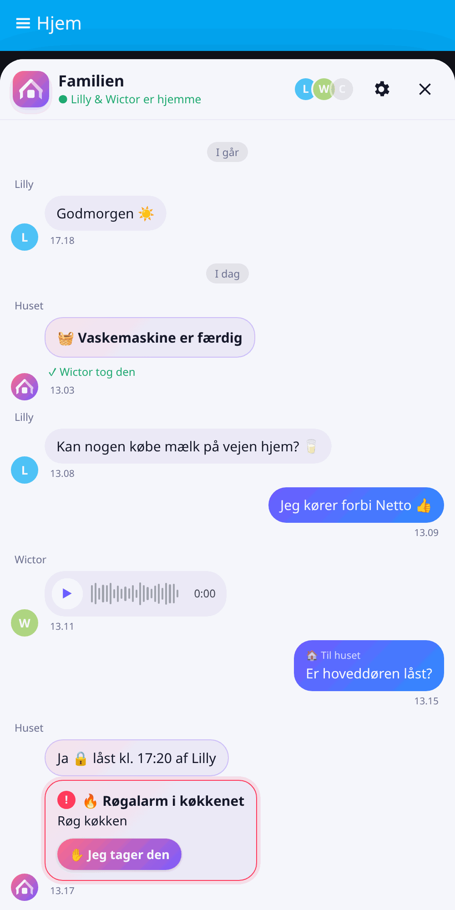
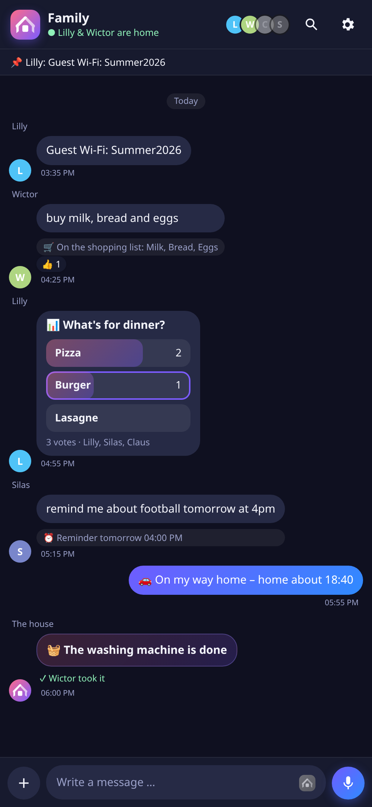
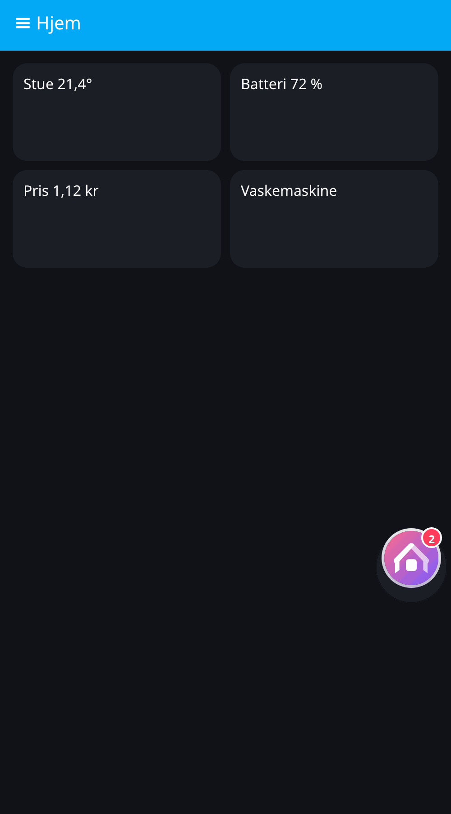

# House Chat · Hus-chat

<p align="center"></p>

**The family's chat in Home Assistant – and the house writes along.**

<p align="center">  </p>

## English

- **A chat bubble on every page of Home Assistant**, like Messenger. A red number for new messages, and a little preview when someone writes. Drag it onto ✕ to close it – it comes back when somebody writes.
- **Write with each other**: text, pictures and voice messages (use the keyboard's microphone to dictate).
- **The house writes along**: "The washing machine is done" with an **I'll take it** button – it's gone from the others' phones when someone takes it, and goes to everyone if nobody does within 10 minutes.
- **Only those at home** get what's about the house (everyone if nobody is home).
- **Ask or control the house**: tap the house in the message field and write "Is the front door locked?" or "Turn off the lights in the living room" – Assist answers in the chat.
- **When the app is closed** the message comes as a notification you can answer right in, or press *I'll take it*.
- **Quiet hours** per person – only urgent messages (smoke, water, alarm) come through.
- **Nothing to set up**: everyone with a person and the Home Assistant app on their phone is in it.

### From automations

```yaml
action: hus_chat.send
data:
  message: "The washing machine is done"
  take: true          # the "I'll take it" button
  to: home            # home (default) · all · or persons: [person.lilly]
  urgent: false       # true: comes through in quiet hours too
  camera: camera.front_door   # optional: a picture goes with it
```

Or send to the House Chat notify entity with `notify.send_message` – it goes to those at home.

### Install

HACS → ⋮ → Custom repositories → `https://github.com/Clahen86/ha-hus-chat` (Integration) → House Chat → Download → restart Home Assistant → Settings → Devices & services → Add integration → **House Chat**.

Pictures and voice messages are kept in `/config/hus_chat` on your own Home Assistant (the last 1,000 messages).

### Help and answers

Settings (⚙️ in the chat) → **🛟 Help** to write what's wrong and attach up to 3 pictures. It goes privately to the developer with a short diagnosis (no names, messages or passwords) – only when you press *Send*. When the developer answers, the answer shows there with a notification in Home Assistant, and you can write back. Errors in the app are sent anonymously so they can be fixed; turn it off under 🛟 Help.

## Dansk

- **En chat-boble på alle sider i Home Assistant**, ligesom Messenger. Et rødt tal for nye beskeder og en lille forsmag, når nogen skriver. Træk den ned på ✕ for at lukke den – den kommer igen, når nogen skriver.
- **Skriv sammen**: tekst, billeder og lydbeskeder (brug tastaturets mikrofon til at tale ind).
- **Huset skriver med**: "Vaskemaskinen er færdig" med knappen **Jeg tager den** – den forsvinder hos de andre, når én tager den, og går til alle, hvis ingen gør det inden 10 minutter.
- **Kun dem, der er hjemme**, får det, der handler om huset (alle, hvis ingen er hjemme).
- **Spørg eller styr huset**: tryk på huset i beskedfeltet og skriv "Er hoveddøren låst?" eller "Sluk lyset i stuen" – Assist svarer i chatten.
- **Når appen er lukket**, kommer beskeden som en notifikation, du kan svare direkte i eller trykke *Jeg tager den*.
- **Stille timer** pr. person – kun det, der haster (røg, vand, alarm), kommer igennem.
- **Intet at sætte op**: alle med en person og Home Assistant-appen på telefonen er med.

### Hjælp og svar

Indstillinger (⚙️ i chatten) → **🛟 Hjælp** for at skrive, hvad der er galt, og vedhæfte op til 3 billeder. Det går privat til udvikleren med en kort diagnose (ingen navne, beskeder eller koder) – kun når du trykker *Send*. Når udvikleren svarer, står svaret dér, og du får en besked i Home Assistant. Du kan skrive tilbage derfra. Fejl i appen sendes anonymt, så de kan blive rettet; slå det fra under 🛟 Hjælp.

## License

MIT
