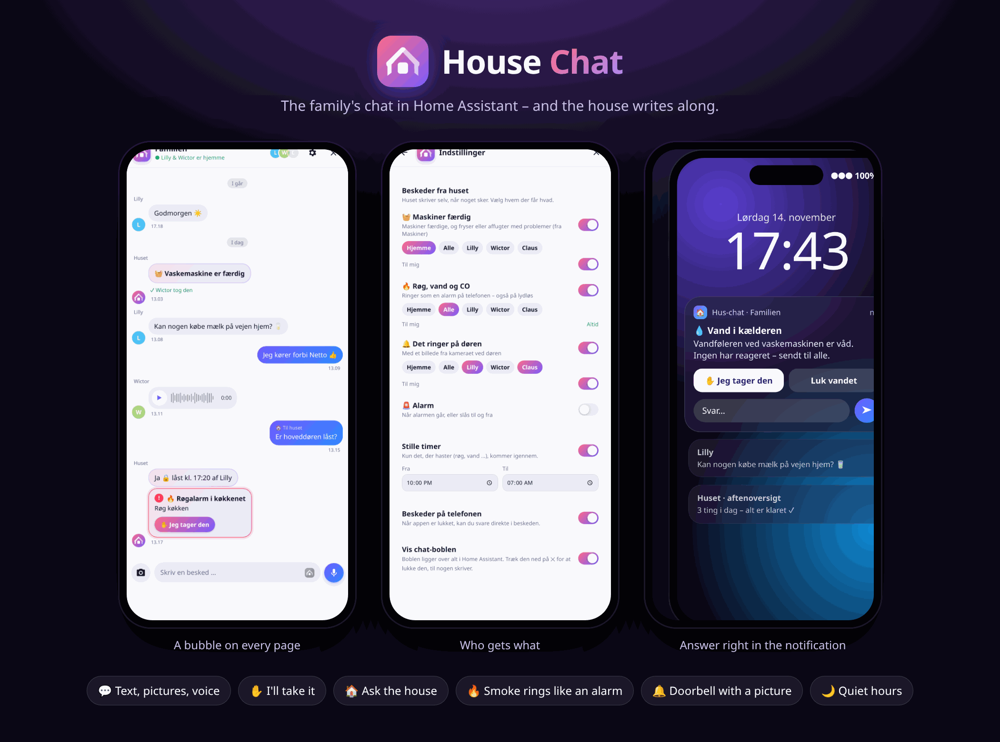

# House Chat · Hus-chat

<p align="center"></p>

**The family's chat in Home Assistant – and the house writes along.**



<p align="center">  </p>

## English

- **A chat bubble on every page of Home Assistant**, like Messenger. A red number for new messages, and a little preview when someone writes. Drag it onto ✕ to close it – it comes back when somebody writes.
- **Write with each other**: text, pictures and voice messages (use the keyboard's microphone to dictate). Everyone sees who wrote what.
- **Ask or control the house**: tap the house in the message field and write "Is the front door locked?" or "Turn off the lights in the living room" – Assist answers in the chat.
- **When the app is closed** the message comes as a notification you can answer right in, or press *I'll take it*.
- **Quiet hours** per person – only urgent messages come through.
- **Nothing to set up**: everyone with the Home Assistant app on their phone is in it – also without a person. Who is home comes from the persons.

### The house writes by itself

Found in your Home Assistant – nothing to set up:

| | |
|---|---|
| 🧺 **Machines** | "The washing machine is done" with **I'll take it** (from [Appliance Watch](https://github.com/Clahen86/appliance-watch)). It's gone from the others' phones when someone takes it, and done by itself when it's emptied. A freezer that stopped or a dehumidifier with a full tank too. |
| 🔥 **Smoke, water, gas, CO** | Rings like an alarm on the phones – also on silent and in quiet hours. Says the room. |
| 🔔 **Doorbell** | With a picture from the camera at the door. |
| 🚨 **Alarm** | When it goes off (urgent), or is armed and disarmed. Off from the start. |

Under ⚙️ → **Messages from the house** an admin picks who gets each kind: *at home*, *everyone* or chosen persons. Each person can turn a kind off for themselves – except smoke and water. If nobody takes a message within 10 minutes, it goes to everyone.

**My phones**: an old phone can be turned off, so it gets no messages. A phone not seen for 30 days is skipped by itself.

### From automations

```yaml
action: hus_chat.send
data:
  message: "The washing machine is done"
  take: true          # the "I'll take it" button
  to: home            # home (default) · all · or persons: [person.lilly]
  urgent: false       # true: comes through in quiet hours too
  camera: camera.front_door   # optional: a picture goes with it
```

Or send to the House Chat notify entity with `notify.send_message` – it goes to those at home.

### Install

HACS → ⋮ → Custom repositories → `https://github.com/Clahen86/ha-hus-chat` (Integration) → House Chat → Download → restart Home Assistant → Settings → Devices & services → Add integration → **House Chat**.

Pictures and voice messages are kept in `/config/hus_chat` on your own Home Assistant (the last 1,000 messages).

### Help and answers

Settings (⚙️ in the chat) → **🛟 Help** to write what's wrong and attach up to 3 pictures. It goes privately to the developer with a short diagnosis (no names, messages or passwords) – only when you press *Send*. When the developer answers, the answer shows there with a notification in Home Assistant, and you can write back. Errors in the app are sent anonymously so they can be fixed; turn it off under 🛟 Help.

## Dansk

- **En chat-boble på alle sider i Home Assistant**, ligesom Messenger. Et rødt tal for nye beskeder og en lille forsmag, når nogen skriver. Træk den ned på ✕ for at lukke den – den kommer igen, når nogen skriver.
- **Skriv sammen**: tekst, billeder og lydbeskeder. Alle kan se, hvem der skriver.
- **Spørg eller styr huset**: tryk på huset i beskedfeltet og skriv "Er hoveddøren låst?" eller "Sluk lyset i stuen" – Assist svarer i chatten.
- **Når appen er lukket**, kommer beskeden som en notifikation, du kan svare direkte i eller trykke *Jeg tager den*.
- **Stille timer** pr. person – kun det, der haster, kommer igennem.
- **Intet at sætte op**: alle med Home Assistant-appen på telefonen er med – også uden en person.

### Huset skriver selv

- 🧺 **Maskiner**: "Vaskemaskinen er færdig" med **Jeg tager den** (fra Maskiner/Appliance Watch). Forsvinder hos de andre, når én tager den, og klares af sig selv, når den er tømt. Også fryser, der er stoppet, og affugter med fuld tank.
- 🔥 **Røg, vand, gas og CO**: ringer som en alarm på telefonen – også på lydløs og i stille timer. Siger hvilket rum.
- 🔔 **Det ringer på døren**: med et billede fra kameraet ved døren.
- 🚨 **Alarm**: når den går (haster), eller slås til og fra. Slået fra fra start.

Under ⚙️ → **Beskeder fra huset** vælger en admin, hvem der får hvad: *hjemme*, *alle* eller bestemte personer. Hver person kan slå en slags fra for sig selv – undtagen røg og vand. Tager ingen en besked inden 10 minutter, går den til alle.

**Mine telefoner**: en gammel telefon kan slås fra. En telefon, der ikke er set i 30 dage, springes over af sig selv.

### Hjælp og svar

Indstillinger (⚙️ i chatten) → **🛟 Hjælp** for at skrive, hvad der er galt, og vedhæfte op til 3 billeder. Det går privat til udvikleren med en kort diagnose (ingen navne, beskeder eller koder) – kun når du trykker *Send*. Når udvikleren svarer, står svaret dér, og du får en besked i Home Assistant. Du kan skrive tilbage derfra. Fejl i appen sendes anonymt, så de kan blive rettet; slå det fra under 🛟 Hjælp.

## License

MIT
