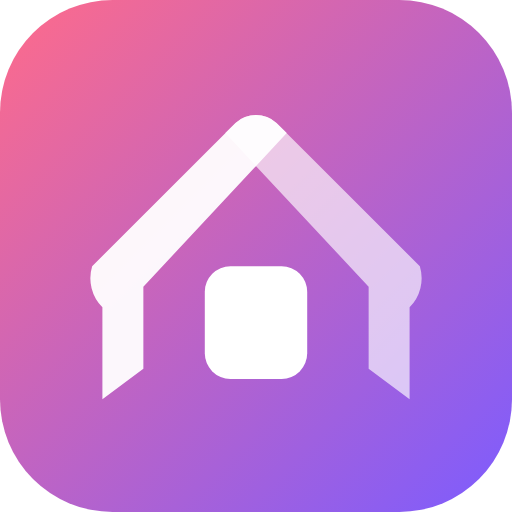
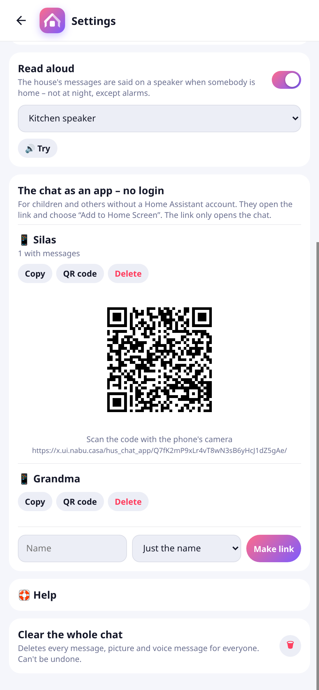

# House Chat · Hus-chat

<p align="center"></p>

**The family's chat in Home Assistant – and the house writes along.**


<p align="center">  </p>

## English

- **A chat bubble on every page of Home Assistant**, like Messenger. A red number for new messages, and a little preview when someone writes. Drag it onto ✕ and it tucks away as a small tab at the edge – tap the tab, or it comes back by itself when somebody writes.
- **Write with each other**: text, pictures and voice messages (use the keyboard's microphone to dictate). Everyone sees who wrote what.
- **Ask or control the house**: tap the house in the message field and write "Is the front door locked?" or "Turn off the lights in the living room" – the house answers in the chat.
- **Or just say it**: with *To the house* on, the microphone works like a voice command – it listens, sends by itself when you stop talking, and the house answers. Nothing is sent if nobody spoke.
- **When the app is closed** the message comes as a notification you can answer right in, or press *I'll take it*.
- **Quiet hours** per person – only urgent messages come through.
- **Nothing to set up**: everyone with the Home Assistant app on their phone is in it – also without a person. Who is home comes from the persons.

### The house writes by itself

Found in your Home Assistant – nothing to set up:

| | |
|---|---|
| 🧺 **Machines** | "The washing machine is done" with **I'll take it** (from [Appliance Watch](https://github.com/Clahen86/appliance-watch)). It's gone from the others' phones when someone takes it, and done by itself when it's emptied. A freezer that stopped or a dehumidifier with a full tank too. |
| 🔥 **Smoke, water, gas, CO** | Rings like an alarm on the phones – also on silent and in quiet hours. Says the room. |
| 🔔 **Doorbell** | With a picture from the camera at the door. |
| 🚨 **Alarm** | When it goes off (urgent), or is armed and disarmed. Off from the start. |

Under ⚙️ → **Messages from the house** an admin picks who gets each kind: *at home*, *everyone* or chosen persons. Each person can turn a kind off for themselves – except smoke and water. If nobody takes a message within 10 minutes, it goes to everyone.

**My phones**: an old phone can be turned off, so it gets no messages. A phone not seen for 30 days is skipped by itself.

### Who answers for the house – your own AI

Under ⚙️ → **🤖 Who answers for the house** an admin picks the AI: any assistant set up in Home Assistant – Google AI, OpenAI, Ollama (local), Home Assistant's own Assist … By default it follows the assistant you chose in Assist. Like Assist's *prefer local commands*, Home Assistant's own Assist tries first – "turn off the lights" is done at once – and only what it doesn't understand goes to the AI. Written and spoken questions go to the same AI, and it remembers the conversation, so you can ask on ("and the kitchen?"). No API keys in House Chat – you connect the AI in Home Assistant, as usual. If the AI can't answer (its free quota is used up, it's offline, or no answer in 45 seconds), Home Assistant's own Assist answers instead, with a small note – and the AI is tried again after 30 minutes.

#### Free AI with Google Gemini (5 minutes)

1. Go to **[aistudio.google.com/apikey](https://aistudio.google.com/apikey)**, sign in with a Google account and press **Create API key**. It's free – no credit card. Copy the key.
2. In Home Assistant: **[Add integration → Google Generative AI](https://my.home-assistant.io/redirect/config_flow_start/?domain=google_generative_ai_conversation)** and paste the key.
3. Open the new integration → **Configure** → set **Control Home Assistant** to **Assist**, so it can turn on lights, read sensors and so on.
4. Settings → **Voice assistants** → your assistant → set **Conversation agent** (and **Speech-to-text**) to Google AI – or pick it just for House Chat under ⚙️ → *Who answers for the house*.

Good to know: the free tier has a daily limit that is far more than a family uses. On the free tier Google may use what you send to improve its products – choose a paid key or a local AI (Ollama) if you don't want that.

### From automations

```yaml
action: hus_chat.send
data:
  message: "The washing machine is done"
  take: true          # the "I'll take it" button
  to: home            # home (default) · all · or persons: [person.lilly]
  urgent: false       # true: comes through in quiet hours too
  camera: camera.front_door   # optional: a picture goes with it
```

Or send to the House Chat notify entity with `notify.send_message` – it goes to those at home.

### Install

HACS → ⋮ → Custom repositories → `https://github.com/Clahen86/ha-hus-chat` (Integration) → House Chat → Download → restart Home Assistant → Settings → Devices & services → Add integration → **House Chat**.

Pictures and voice messages are kept in `/config/hus_chat` on your own Home Assistant (the last 1,000 messages).

### Help and answers

Settings (⚙️ in the chat) → **🛟 Help** to write what's wrong and attach up to 3 pictures. It goes privately to the developer with a short diagnosis (no names, messages or passwords) – only when you press *Send*. When the developer answers, the answer shows there with a notification in Home Assistant, and you can write back. Errors in the app are sent anonymously so they can be fixed, once a day with how it is set up (which AI, how many phones, which house messages are on – never names or messages); turn it off under 🛟 Help. *Share my setup* there also sends the full entity names.

## Dansk

- **En chat-boble på alle sider i Home Assistant**, ligesom Messenger. Et rødt tal for nye beskeder og en lille forsmag, når nogen skriver. Træk den ned på ✕, så gemmer den sig som en lille fane i kanten – tryk på fanen, eller den kommer selv, når nogen skriver.
- **Skriv sammen**: tekst, billeder og lydbeskeder. Alle kan se, hvem der skriver.
- **Spørg eller styr huset**: tryk på huset i beskedfeltet og skriv "Er hoveddøren låst?" eller "Sluk lyset i stuen" – huset svarer i chatten.
- **Eller sig det bare**: med *Til huset* slået til virker mikrofonen som en stemmekommando – den lytter, sender selv, når du holder op med at tale, og huset svarer. Siger du ikke noget, sendes der intet.
- **Når appen er lukket**, kommer beskeden som en notifikation, du kan svare direkte i eller trykke *Jeg tager den*.
- **Stille timer** pr. person – kun det, der haster, kommer igennem.
- **Intet at sætte op**: alle med Home Assistant-appen på telefonen er med – også uden en person.

### Huset skriver selv

- 🧺 **Maskiner**: "Vaskemaskinen er færdig" med **Jeg tager den** (fra Maskiner/Appliance Watch). Forsvinder hos de andre, når én tager den, og klares af sig selv, når den er tømt. Også fryser, der er stoppet, og affugter med fuld tank.
- 🔥 **Røg, vand, gas og CO**: ringer som en alarm på telefonen – også på lydløs og i stille timer. Siger hvilket rum.
- 🔔 **Det ringer på døren**: med et billede fra kameraet ved døren.
- 🚨 **Alarm**: når den går (haster), eller slås til og fra. Slået fra fra start.

Under ⚙️ → **Beskeder fra huset** vælger en admin, hvem der får hvad: *hjemme*, *alle* eller bestemte personer. Hver person kan slå en slags fra for sig selv – undtagen røg og vand. Tager ingen en besked inden 10 minutter, går den til alle.

**Mine telefoner**: en gammel telefon kan slås fra. En telefon, der ikke er set i 30 dage, springes over af sig selv.

### Hvem svarer for huset – din egen AI

Under ⚙️ → **🤖 Hvem svarer for huset** vælger en admin AI'en: enhver assistent, der er sat op i Home Assistant – Google AI, OpenAI, Ollama (lokal), Home Assistants egen Assist … Som standard følger den den assistent, du har valgt i Assist. Ligesom Assists *foretræk lokale kommandoer* prøver Home Assistants egen Assist først – "sluk lyset" klares med det samme – og kun det, den ikke forstår, går til AI'en. Skrevne og talte spørgsmål går til samme AI, og den husker samtalen, så du kan spørge videre ("og i køkkenet?"). Ingen API-nøgler i Hus-chat – du tilkobler AI'en i Home Assistant, som du plejer. Kan AI'en ikke svare (den gratis grænse er brugt op, den er offline, eller intet svar på 45 sekunder), svarer Home Assistants egen Assist i stedet med en lille note – og AI'en prøves igen efter 30 minutter.

#### Gratis AI med Google Gemini (5 minutter)

1. Gå til **[aistudio.google.com/apikey](https://aistudio.google.com/apikey)**, log ind med en Google-konto og tryk **Create API key**. Det er gratis – uden betalingskort. Kopiér nøglen.
2. I Home Assistant: **[Tilføj integration → Google Generative AI](https://my.home-assistant.io/redirect/config_flow_start/?domain=google_generative_ai_conversation)** og indsæt nøglen.
3. Åbn den nye integration → **Konfigurer** → sæt **Styr Home Assistant** til **Assist**, så den kan tænde lys, læse sensorer osv.
4. Indstillinger → **Stemmeassistenter** → din assistent → sæt **Samtaleagent** (og **Tale-til-tekst**) til Google AI – eller vælg den kun til Hus-chat under ⚙️ → *Hvem svarer for huset*.

Godt at vide: den gratis udgave har en daglig grænse, som er langt mere, end en familie bruger. På den gratis udgave må Google bruge det, du sender, til at forbedre sine produkter – vælg en betalt nøgle eller en lokal AI (Ollama), hvis du ikke vil det.

### Hjælp og svar

Indstillinger (⚙️ i chatten) → **🛟 Hjælp** for at skrive, hvad der er galt, og vedhæfte op til 3 billeder. Det går privat til udvikleren med en kort diagnose (ingen navne, beskeder eller koder) – kun når du trykker *Send*. Når udvikleren svarer, står svaret dér, og du får en besked i Home Assistant. Du kan skrive tilbage derfra. Fejl i appen sendes anonymt, så de kan blive rettet, én gang om dagen sammen med opsætningen (hvilken AI, antal telefoner, hvilke beskeder fra huset der er slået til – aldrig navne eller beskeder); slå det fra under 🛟 Hjælp. *Del min opsætning* dér sender også de fulde entity-navne.

## License

MIT
